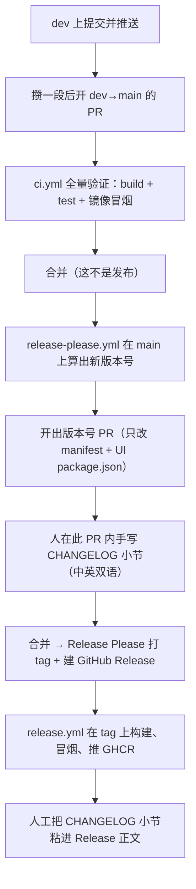

# AGENTS.md

> 面向 AI 编码代理的仓库指南。**只写「跑一遍代码库也发现不了」的内容**——命令、依赖铁律、
> 同步点、高频陷阱。约定详情一律链接 `docs/`，不要把 `docs/` 的内容抄进来。

## 项目定位

类 Portainer 的轻量 Docker 管理平台。**当前处于 0.x 功能迭代期**：未正式发布、API 可能破坏性变更，
**唯一目标版本是 `1.0.0`**（先出 `1.0.0-rc.N`）。0.x 全程**不打 tag、不推 GHCR**。
仓库**没有** `CONTRIBUTING.md` / `SECURITY.md` / `CODE_OF_CONDUCT.md`，
且这是**有意为之**——任何文档都不得链接它们（README 里曾有的链接已删）。

| 项目 | 位置 | 职责 |
|------|------|------|
| `Whalefleet.Core` | `src/` | 业务实体、值对象、枚举、仓储接口。**仅 BCL，无任何 NuGet** |
| `Whalefleet.Application` | `src/` | 用例编排、DTO、外部资源接口抽象 |
| `Whalefleet.Infrastructure` | `src/` | Docker SDK 适配、SQLite 仓储实现、安全组件 |
| `Whalefleet.Api` | `src/` | ASP.NET Core 10 宿主：Controllers、中间件、Serilog、DI |
| `Whalefleet.UI` | `src/` | Vue 3 + TS + UnoCSS + Element Plus 单工程 |
| `Whalefleet.UnitTests` | `tests/` | xUnit 单测。**不得引用 Api / Infrastructure** |
| `Whalefleet.IntegrationTests` | `tests/` | `WebApplicationFactory` + 真实 Docker socket。唯一允许 `Mvc.Testing` |

---

## 构建 / 测试 / 校验

后端（仓库根）：

````bash
dotnet build -c Release --nologo          # 与 CI 一致的构建
dotnet build -c Release -nologo -t:Rebuild # 查全量警告（见下方铁律）
dotnet test  -c Release                    # 一次跑完单测 + 集成测试
````

前端（`src/Whalefleet.UI/`，用 pnpm）：

````bash
pnpm install
pnpm typecheck    # vue-tsc --noEmit（⚠️ 目前是**空跑**，见下方说明）
pnpm lint         # eslint . --max-warnings 0
pnpm test         # vitest run
pnpm build        # typecheck + 生产构建

# ⚠️ 真正做类型检查（`pnpm typecheck` 目前不检查任何文件）：
npx vue-tsc -p tsconfig.app.json --noEmit
```

> ⚠️ **`pnpm typecheck` 是空跑**：根 `tsconfig.json` 是 solution 形态
> （`files: []` + `references`），`vue-tsc --noEmit` **一个文件都不检查**
> （只有 `--build` 模式才会走 references）。因此 `pnpm build` 的第一步也是空跑，
> **类型错误要到运行时才暴露**。
> 改前端代码后请用上面那条 `npx vue-tsc -p tsconfig.app.json --noEmit`——
> 但注意它会暴露一批**既存**错误，所以要**与基线对比**（逐文件计数 diff），
> 而不是看错误的绝对数。`

### 零警告铁律

`Directory.Build.props` 设了 `TreatWarningsAsErrors=true`，**警告即错误**。
但 `CodeAnalysisTreatWarningsAsErrors=false`，所以 `CA*` 分析器警告不致命——**仍然应清零**。

> ⚠️ **增量构建只报被重编译文件的警告**。改了 `Api` 再构建，看起来「只有 CA1014」，
> 但 `Application` / 测试项目里的 CA1859 / CA1307 / CA1861 只有全量 `-t:Rebuild` 才暴露。
> **不要据增量构建的结果断定自己没引入警告。**

> ⚠️ **前端改样式必须 `pnpm build` 后验产物**。UnoCSS 主题变量的错误是**编译期静默失败**
> ——`--brand-*` 写成十六进制，所有 `brand-*` 类全部消失且无任何报错。只看代码或 dev server 不足以确认。

---

## 架构与依赖铁律

分层依赖方向（箭头 = 引用方向）：`Core` ← `Application` ← `Infrastructure` ← `Api`，
`Core` ← `Infrastructure`，`Core` / `Application` ← 两个测试项目。

验证手段：

````bash
# Core 应无任何 NuGet 依赖（输出为空）
dotnet list src/Whalefleet.Core/Whalefleet.Core.csproj package --include-transitive
````

### 充血模型（非 DDD）

DDD 战术模式（聚合根 / 领域事件 / 领域服务）**已整体移除**。

- 实体的行为与不变量写在**实体自身的方法**里，推荐「私有构造 + 静态工厂」
- 不变量违反 → 抛 BCL **`ArgumentException`**（中间件映射 `1000` / 400）
- 用例执行失败（外部资源不可用、规则不允许）→ 抛 **`BusinessException`**（`Application/Common/`，自带错误码）
- **Entity 不得直接作为 HTTP 响应返回**，在应用服务里做 Entity → DTO 映射
- 枚举**仅用于封闭集合**；可运行时扩展的概念（如角色）必须建表 + 实体

### 接口归属判据

| 类型 | 归属 | 判据 |
|------|------|------|
| 业务概念（"管理 X"） | `Core` | 去掉整个外部世界后概念仍成立 |
| 外部资源抽象（"操作外部系统"） | `Application/Abstractions` | 抽象的是某种外部系统 |
| 第三方 SDK 适配 | `Infrastructure` | 包装 / 适配某个具体 SDK，可直接替换 |

**推论**：外部资源接口的**入参 / 返回类型**同样受约束。`DockerHostType`、`DockerHostConnection`
这类类型放 `Application/Abstractions` 而非 `Infrastructure`，否则 `Application` 就要反向引用
`Infrastructure`，依赖方向当场破裂。

### 反模式（见到就改）

| 反模式 | 表现 |
|--------|------|
| 贫血模型 | 实体只有属性，逻辑全在 Service |
| Entity 直接返回 DTO | Controller 直接拿 Entity 序列化 |
| `Core` 引用 NuGet | `Core.csproj` 含 `PackageReference` |
| `Application` 引用 `Infrastructure` | 应用服务直接 `new SqliteConnection()` |
| 审计属性开 `public set` | 绕过 `MarkCreated` / `MarkModified` |
| 为 Dapper 另建 Row DTO | 实为多余，见下方陷阱清单 |

---

## 关键约定（易踩）

### 新增错误码要同步 5 处

漏一处**守卫测试必挂**。同步点：

1. `Application/Common/ErrorCodes.cs` — 常量
2. `Application/Common/ErrorCodeCatalog.cs` — 分类（`ErrorCategory`）+ 默认文案
3. `Api/Errors/ErrorHttpStatus.cs` — 语义分类 → HTTP 状态码
4. 守卫测试：`UnitTests/Common/ErrorCodesTests.cs` + `IntegrationTests/Errors/ErrorHttpStatusTests.cs`
5. [docs/api-spec.md](docs/api-spec.md) — 错误码分段表

未登记的错误码**兜底为 `Internal` / 500**，**不按数值分段推断**。

### 其他后端约定

- **响应**：`ApiResult`（无 data）/ `ApiResult<T>`（含 data）+ `ApiResults` 静态工厂。
  工厂类**不能是泛型静态类**（触发 `CA1000`）。失败响应必须显式含 `"data": null`。
- **中间件管道顺序勿动**：`ExceptionHandlingMiddleware` → `UseSerilogRequestLogging`
  → `UseStatusCodePages` → `UseCors` → endpoints
- `throw;` **只能写在 catch 块内**。中间件用 `HandleExceptionAsync` 返回 bool，重抛留在 catch
- **API 是 RPC 风格**：`POST /api/v1/hosts/{hostId}/containers/start`，
  而非 `PUT /api/v1/hosts/{hostId}/containers/{id}`。`hostId` **只出现在路径中**，任何请求体都不得含它
- **`hostId` 就是 `DockerHost.Name`**（不区分大小写），**不是** `hosts.id`（那个 `Guid` 不进 URL）
- **配置优先级**：`appsettings.json` → `appsettings.{Env}.json` → 环境变量 → 命令行。
  层级用 `__`，数组用数字下标，键比较不区分大小写。
  ⚠️ `appsettings.json` 的 `Urls` **优先于** `ASPNETCORE_URLS`——改端口用 `--urls` 或 `URLS`
- **CORS 策略必须经 `IConfigureOptions<CorsOptions>` 延迟注册**；DI 注册期读配置会读到空值，
  静默不注册任何策略
- **每个新 API 端点必须配集成测试**，CI 卡

### 前端约定

- `types/api.ts` 必须与后端投影**逐字对应**；`ErrorCode` 常量表也在这里，
  与 `mocks/envelope.ts` 一起构成错误码的后端 5 处之外的**前端同步点**
- **角色与权限是后端契约，不是前端清单**：权限矩阵必须遍历
  `POST /api/v1/admin/roles/permissions` 的响应渲染，禁止在前端硬编码权限名；
  `stores/auth.ts` 的 `isAdmin` 按权限集判定（`utils/roles.ts` 的 `ADMIN_PERMISSIONS`），
  **不看角色名**——角色是数据，自定义角色同样能带全部权限
- **分配请求体的字段名是 `host`（主机名）而不是 `hostId`**：JSON 里多一个后端不认识的字段
  不会报错，只会被当成「没给 host」＝ 全局分配，症状是「勾了某台主机却生效到了所有主机」
- 纯逻辑放 `src/utils/*.ts` 并**返回 i18n key 而非文案**（可脱离组件单测）
- **禁止在模板里拼 i18n key**（如 `` t(`container.restartPolicy.${v}`) ``）——
  Docker 给的是 `unless-stopped`，key 是 `unlessStopped`，拼出来会显示原始 key 路径，
  且 vue-i18n 只告警不报错。改用显式 `Record` 映射 + 回退原值
- `el-option` **不接受 `null` 作为 `:value`**（控制台刷 type check 失败）。用空串表达「未分组 / 无」，
  提交时再转 `null`
- mock 必须**复刻易忽略的语义**（pageSize 夹紧、409/1404、tail 越界、创建后能接着 start），
  否则前端分支测不到
- **实时通道在 mock 模式下走的是另一条通路**：SignalR 是 WebSocket / 长轮询，
  **MSW 拦不住**。因此 mock 的实时数据由 `src/realtime/mock.ts` 用定时器造，
  而**门控必须写在调用点**（`import.meta.env.DEV && shouldUseMock()`），
  否则那段代码会进生产产物
- **虚拟滚动的行高不能交给 UnoCSS 的行高类**：行高必须精确等于常量，
  否则位置计算整体偏移。`LogViewport.vue` 因此把行高写在 scoped CSS 里
- **通知文案只给 i18n key + 参数**（`stores/notifications.ts` 的 `describe`），
  不要在 store 里拼死文案——同一件事会出现在 toast 与铃铛下拉两处
- **五个列表页共用 `ListToolbar`**（容器 / 镜像 / 卷 / 网络 / 主机）：
  工具条固定放在**卡片头部右侧**，并且**分三组**：
  ① 筛选（搜索 → 状态下拉 → 命中计数）│ ② 批量（动作 + 已选计数 + 清空）│
  ③ 页面操作（图标刷新 → 列设置）。组间是 `gap-x-4` + 一条 1px 竖线，
  **不是审美问题**：三组回答的是三个不同问题（找哪几条 / 对它们做什么 /
  这一页怎么刷新与显示），挤成一排时批量按钮会被读成搜索栏的附属品。
  竖线 `hidden md:block`——窄屏折行时它若落在行首像多刷了一道。
- **批量动作用「图标 + 文字」+ 标准带框按钮，行内动作才用纯图标**：
  行内一个图标是刻意的（一行四五个配文字会把表格撑宽），但工具条上的批量动作
  是「这一页支持批量操作」的唯一提示、且是高频动作，纯图标得逐个悬停才分得清启动与删除。
  用 `IconActionButton` 的 `show-label`：文字写在按钮上、**用 `plain`（标准带框 el-button）**，
  tooltip 只留禁用原因。
  ⚠️ `show-label` 时必须是 `plain` 而不是 `text`（无边框）——工具条上的批量动作是
  「可以点的正式按钮」，行内动作是「表格里的小图标」，两者同外观会分不清。
  批量按钮之间用 `gap-1`（4px）读成一个按钮组，与「已选 N / 取消选择」之间的
  `gap-2` 区分开。批量按钮还必须**常驻**（未选中时禁用）——「选中才出现」的批量条入口不可发现，
  而常驻 + 禁用既有可发现性、也不会让人怀疑页面坏了。
  刷新按钮用 `i-carbon-renew` 图标，且图标要放在 `el-button` 的 **`icon` 插槽**里
  （不是默认插槽）：EP 在 `loading` 时会用转圈图标**替换** `icon` 插槽的内容，
  两个都渲染就成了「转圈 + 图标」
- **列表的搜索与筛选一律走服务端**：分页也是服务端内存切片，
  前端过滤只能筛到当前页——页脚会显示一个与翻页结果对不上的数字
- **端口展示用 `describePorts()`**（`utils/container-status.ts`）：
  它按「宿主端口 + 容器端口 + 协议」分组，**一行一个映射**；
  **未映射的端口（`publicPort` 为 null）直接不显示**——镜像 `EXPOSE` 过的端口
  守护进程会一并报回来（MySQL 的 `33060` 就是这么来的），
  而没映射到宿主的端口从宿主机外根本连不上，列出来只会让人以为「这里还有个服务」；
  链接只给 **TCP**（UDP 没有浏览器能直接打开的语义），
  且固定 `http://`（端口映射里没有协议信息，猜错会被读成「服务挂了」）

---

## 常见陷阱（docs 未记载，但极易踩）

| # | 陷阱 | 后果 / 正确做法 |
|---|------|----------------|
| 1 | **Dapper 需显式开 `MatchNamesWithUnderscores`** | 否则 `creation_time` 静默丢值 |
| 2 | **Dapper 参数绑定绕过 `ITypeHandler`** | 值类型直接装箱，只有物化路径生效。Guid 写入必须 `ToStorageText()` 转小写 36 位；枚举必须转小写文本 |
| 3 | **集成测试宿主必须 `Persistence:Pooling=false`**（4 个测试宿主全设） | `ClearAllPools()` 是进程级操作，会释放并行测试正在用的句柄（约 1/14 概率偶发 `ObjectDisposedException`）→ **禁止在测试里调 `ClearAllPools()`** |
| 4 | **迁移版本须从 1 连续** | `PRAGMA user_version` 跳号则启动失败 |
| 5 | **默认主机种子不能写进迁移** | 迁移先于种子执行，那时 `hosts` 表还是空的。归属在 `DatabaseInitializer.SeedDefaultHostAsync` |
| 6 | **仓储「未命中」返回 `false`，不抛异常** | 错误码由应用服务决定 |
| 7 | **`IHasModificationTime` 等审计接口全部只读** | 开 `set` 即绕过不变量 |
| 8 | **仓库统一 LF**（`.editorconfig` + `.gitattributes` 的 `* text=auto`）；`[*.sh]` 显式 LF | shell 脚本含 CR 会在容器里以 `\r: command not found` 失败 |
| 9 | **El 浮层在暗色下变白底** | `main.ts` 必须**显式 import** `element-plus/theme-chalk/dark/css-vars.css`（EP 暗色是独立可选包），放在 `element-plus/dist/index.css` 之后、`main.css` 之前 |
| 10 | **UnoCSS 必须 `darkMode: 'class'`** | 项目主题开关由 `<html class="dark">` 驱动；默认 `prefers-color-scheme` 会让「手动选亮色但系统是暗色」无法保持 |
| 11 | **`--brand-50..900` 必须写成空格分隔的 RGB 通道**（如 `--brand-500: 64 158 255`） | `uno.config.ts` 映射为 `rgb(var(--brand-N) / <alpha-value>)`；写十六进制 → `var()` 非法 → **所有 brand 类静默失效** |
| 12 | **路由参数不要自己 `encodeURIComponent`** | vue-router 会再编码一次（`sha256:` → `sha256%253A`），详情页拿到的 id 永远对不上。传原始值，`route.params` 读回来已解码 |
| 13 | **MSW 路径正则结尾别多写 `/`** | `/([^/]+)/update$/` 永远匹配不上（要求路径结束后还有斜杠），表现为端点 404 |
| 14 | **模板里用到但从 script 删掉的 import**，Vue 只在渲染时报 `is not a function` | **整块内容空白且 v-loading 卡住**，看不出是编译问题。改完 import 必须真跑一次页面 |

| 15 | **`.NET 8+ 的 aspnet 基础镜像自带 `app` 用户，UID 是 1654** | `groupadd --gid 10001 app` 会以 `group 'app' already exists` 失败，把镜像构建卡死。改用 `groupmod --gid` / `usermod --uid` |
| 16 | **aspnet 运行时镜像不含 `curl` 与 `sqlite3`** | 健康检查会退化成「进程还在」（挡不住「进程活着但 SQLite 打不开」）；README 让人在容器内跑备份脚本也会失败。两者都要在 runtime 阶段显式装 |
| 17 | **`MapFallbackToFile` 会吞掉打错的 `/api` 路径** | 症状是「接口返回 200 + HTML、日志里全是成功」，前端表现为 JSON 解析失败，几乎不可能靠读日志定位。SPA 回退必须显式排除 `/api` 与 `/healthz`。**0.5.0 起还要排除 `/hubs` 与 `/ws`**——排除漏了 `/hubs` 的症状是「实时通道连不上，但日志里全是 200」：回退中间件跑在端点**之前**，它把响应写成 index.html，Hub 根本轮不到处理 |
| 18 | **SPA 回退必须挂在 `UseCurrentHost` 之前** | 前端 `/hosts/{hostId}/...` 与接口 `/api/v1/hosts/{hostId}/...` 同前缀，而 `UseCurrentHost` 会把任何请求的 `hostId` 路由值当主机查库。放在它之后，每次刷新深链都先抛「主机不存在」 |
| 19 | **`AddHealthChecks().AddCheck<T>(name)` 里的 `name` 不能省** | 直接注册 `IHealthCheck` 会以**实现类全名**作为注册项名字，而 `HealthCheckService` 按名字索引结果——结果是 `/healthz` 永远查不到该项，只能回退成 unhealthy |
| 20 | **`apiFactory.WithSetting` 是就地修改（返回 `this`）** | 打在类共享的 `IClassFixture` 上会把配置留给本类**其他**用例，表现为「随机顺序下某条用例莫名失败」。需要坏配置时必须 `new ApiFactory()` |
| 21 | **compose 的两种部署模式必须用 `profiles` 隔离，不能靠注释** | 两个 service 若共用 `container_name`，同时启动会直接冲突；而注释掉一个会让「另一种模式」在文件里彻底消失 |
| 22 | **`sqlite3 .backup` 而非 `cp`** | 直接拷数据库文件拷到的是某一瞬时状态，正在写事务时可能拷出撕裂的文件，恢复时才报 `database disk image is malformed` |
| 23 | **`.dockerignore` 里的 `**/data` 会吃掉前端源码** | `src/Whalefleet.UI/src/mocks/data/` 是 mock 场景源码，被排除后构建以 `Could not resolve "./data/hosts"` 收场，且**无任何提示指向 .dockerignore**。运行期数据目录只能写 `/data`（仅仓库根） |
| 24 | **`jwt.key` 必须随数据库一起备份** | 恢复备份时若漏掉它，程序会生成新密钥 → 旧令牌全废、所有在线用户被静默登出，**无任何报错**。`scripts/backup.sh` 已把密钥拷成 `<备份名>.db.jwt.key`；修改该脚本时别把这个附带拷贝漏了 |
| 25 | **密码永不进日志** | 自动生成的初始管理员密码只写在 `/app/data/initial-admin.txt`。日志会被采集器上报到集中式系统，打印密码等于把它扩散出去。`AdminBootstrapperTests` 有一条用例专门拦这个 |
| 26 | **`Volumes.RemoveAsync` 会忽略 `force` 参数** | `Docker.DotNet.Enhanced` 4.3.3 实测：两次调用的 HTTP 请求行完全一样（查询串里**没有** `?force=`），而守护进程带该参数时返回 204 而非 404。透传等于没传——`VolumeService` 的幂等语义只能自己实现（先 inspect，不存在就当已删；**只吞 404**，否则主机不可达会被静默当成「删干净了」） |
| 27 | **卷的 `force` 删不掉被引用的卷** | 只要还有容器挂着该卷，守护进程就拒绝，带不带 `force` 都一样（容器运行或已停止都一样）。`force` 唯一的作用是让「卷不存在」变成成功。把字段文档写成「强制删除」会让人以为能删、点了却没反应 |
| 28 | **`GET /networks` 不返回 `Containers`**，只有 `/networks/{id}` 返回 | 列表里的「容器数」只能恒为 0。宁可不给这个字段——界面上「0 个容器」会被读成「这个网络没在用」，而它可能正承载着几十个容器 |
| 29 | **网络 ID 没有 `sha256:` 前缀**（镜像 ID 才有） | `/networks` 返回裸的 64 位十六进制。照搬镜像的剥前缀逻辑会得到一个错 ID，表现为 404，且极难联想到是前缀问题 |
| 30 | **Docker 26 把内置网络 `null` 改名成 `none`** | 保护名单两个都要收，旧守护进程上才拦得住。测试的 `InlineData` 只列本机真实存在的，否则拿到的是 404 而不是要验的 1404 |
| 31 | **未启动的容器不出现在 `GET /networks/{id}` 的 `Containers` 里** | `docker create` 后、`docker start` 前是 0 个。exec 同理要求容器**运行中**（对已创建的容器回 409）。写集成测试时漏掉 start，会看到一个与被测行为无关的「0 个容器」 |
| 32 | **`.gitignore` 的 `**/data/` 会吃掉 `src/Whalefleet.UI/src/mocks/data/`** | 那是 mock 场景**源码**。与陷阱 23（`.dockerignore`）同根不同文件。**已跟踪文件不受 ignore 影响**，所以从既有文件完全看不出异常——症状是**新增**一个 mock 夹具后 `git status` 里根本没有它，且无任何报错。只列举运行期会写出 `data/` 的位置：`/data`、`src/*/data/`、`tests/*/data/`；新增 mock 夹具后用 `git check-ignore -v <file>` 应无输出 |
| 33 | **vue-i18n 把消息正文里的 `{` 当占位符编译** | `JSON 对象，如 {"VERSION":"1.0"}` 会在首次渲染到时抛 `Message compilation error: Invalid token in placeholder`。词条文件是合法 JSON、中英 key 集合一致、`pnpm build` 也全过，只有真正渲染到那一句才炸（常藏在默认折叠区）。字面花括号必须转义成 `{'{'}` / `{'}'}`（各**五个**字符，少一个收尾的 `}` 会变成 `Unterminated closing brace`）。`i18n.spec.ts` 有守卫：用真实 i18n 实例把每条词条两种语言各 `t()` 一次 |
| 34 | **组件渲染错误只有 mount 才暴露** | 模板引用了 `<script setup>` 没导出的函数 → Vue 只 console 告警，该段渲染成空白、退出码 0（即陷阱 14）。`tests/render-smoke.spec.ts` 用 `@vue/test-utils` mount + 收集 `console.warn` 守卫。两个搭架子要点：① `ElementPlus` 必须作为插件注册，否则 `el-table` 解析失败会被当原生元素渲染，`#default="{ row }"` 抛 `Cannot destructure property 'row' of undefined`（错看着像业务代码坏了）；② 必须**先 `router.push()` 再 `router.isReady()`**，否则首次导航没被触发，测试直接超时 |
| 35 | **`GET /volumes` 不返回 `UsageData`**（实测） | 占用 / 引用数只能从 `GET /system/df?type=volume` 取，列表接口里每一项都**没有**该键——读它永远是 0，界面就只剩「—」。`type=volume` 过滤不能省（否则顺带统计镜像层，慢好几秒）。用量查询失败要降级成 `null`（「不知道」），**不能给 0**（那是「确实是 0」）。同理：**下拉框用的列表要显式要 `pageSize: 100`**，默认 20 条会让选项悄悄缺一大截 |
| 36 | **`/info` 的 `SystemTime` 是「当前时间」不是「启动时间」** | moby `daemon/info.go` 里就是 `SystemTime: time.Now().Format(time.RFC3339Nano)`，官方 API 文档写的是 "Current system-time"——**每次调用都返回当下时刻**。拿它算「已运行 x」恒为 0 秒。**Docker Engine API 不提供守护进程启动时刻，也不提供宿主 boot time**（`/info` 无、`/version` 无、`/events` 只是内存环形缓冲），所以这不是「映射错字段」而是「信息根本不存在」——换任何字段都换不出真的。⚠️ 反向陷阱：**容器级**的 `State.StartedAt` 是真的启动时刻，不要一并删掉。`0.6.0` 移除主机侧的 `startedAt` |

| 37 | **SignalR 的 `MapHub` 不支持路由参数** | 路径里的 `{hostId}` 只参与**路径匹配**，**不会**出现在 `HttpContext.Request.RouteValues` 里（实测该字典的键集合为空）。症状是「Hub 方法里读 `RouteValues["hostId"]` 永远是 null」，而连接本身完全正常（连接建立、鉴权都过了）——极难联想到是路由值的问题。**只能从请求路径解析**（见 `RealtimeHostResolver.ResolveHostId`）。推论：**不要在 Hub 里依赖路由值** |
| 38 | **Docker 的日志回调是「逐行」且「不含换行符」** | `GetContainerLogsAsync` 的 `IProgress<string>` 回调**每次给一整行，行尾没有 `\n`**（实测：块长 6 = `"line-2"`）。把回调内容直接拼接会得到 `"helloworld"`——所有日志挤成一行。旧实现正是如此，且**在 mock 模式下完全看不出来**（mock 数据是手工写的带换行文本）。配套两条：① 回调必须**同步**实现——`System.Progress<T>` 会把回调扔到线程池，**重排顺序**；② 跟随任务只在**流结束**时完成，**不能 await** 它（await 等于把枚举卡死） |
| 39 | **`pnpm typecheck` 目前是空跑** | 根 `tsconfig.json` 是 solution 形态（`files: []` + `references`），`vue-tsc --noEmit` **不检查任何文件**（`--build` 模式才会走 references）。因此 `pnpm build` 的第一步也是空跑——**类型错误要到运行时才暴露**。要真正检查：`npx vue-tsc -p tsconfig.app.json --noEmit`（注意它会暴露一批**既存**错误，改代码前后要**对比基线**而不是看绝对数） |
| 40 | **`?access_token=` 只在 `/hubs` 前缀下被接受** | 服务端只在 `/hubs` 开头的路径上把查询参数改写成 `Authorization: Bearer` 头。其它路径带了它会被**忽略**（而不是被当成有效凭证）——这是刻意的：否则任何带这个查询串的普通接口都会被「顺带」鉴权，CORS / 缓存 / 访问日志的行为都变得不可预测。前端**推荐**用 `accessTokenFactory` 而不是把令牌拼进 URL：URL 在连接建立时只算一次，而令牌会变 |
| 41 | **日志与统计的订阅上限必须分开** | 两者共用 `RealtimeOptions.MaxSubscriptionsPerKind`（5）时，「列表里 20 个容器加指标列」只能有前 5 个有数据。统计独立为 `MaxStatsSubscriptionsPerConnection`（20）；共用上限的症状是**界面不报错、只是大部分行永远是「—」** |
| 42 | **容器列表接口不返回健康与重启计数** | `/containers/json` 只把健康写在 `status` 文本里，`restartCount` / `exitCode` / `oomKilled` 只有 inspect 才有。因此列表健康列走批量端点 `POST .../containers/health`（≤100 项、并发 8）：把 N 次 inspect 绑进每 5 秒的列表刷新等于把刷新成本放大 N 倍 |
| 43 | **`healthStatus` 的 `none` 不是 `null`** | 「没配健康检查」是永远不会变的事实，「查不到」是另一件事。返回 `null` 会让界面把两者混为一谈；`none` 是**契约值**，mock 与前端类型必须跟着改 |
| 44 | **ECharts 必须懒加载，且颜色不能硬编码** | 直接 `import 'echarts'` 会让整包进主 bundle（实测按需引入后仍是 ~176KB gz）。另外 canvas **不继承 CSS 变量**：颜色要在运行时 `getComputedStyle` 读取，并在主题切换时重新 `setOption`，否则暗色下网格与文字看不清 |
| 45 | **删除标签要先删关联** | `host_tag_assignments` 对 `host_tags` 有外键，软删标签不删关联会让「同名标签重建」继承旧关联。打标/清标用 `INSERT OR IGNORE` / `DELETE` 实现幂等；`host_id` 存的是 `hosts.id`（Guid 小写 36 位），**不是主机名**——主机名可改 |
| 46 | **手动 `stop` 也会产生 `die` 事件** | 只订 `die` / `oom` 时，`docker stop` 也会弹「异常退出」。必须同时订 `stop` / `kill`，并用 10 秒窗口吞掉随后的 `die`；`oom` + `die` 是**同一次死亡的两条事件**，要去重 |
| 47 | **`el-select` / `el-input` 上的 `w-*` 工具类会静默失效** | Element Plus 把这两者的宽度写死成 `var(--el-select-width)` / `var(--el-input-width)`（默认都是 **100%**），而 `main.ts` 里 **EP 的样式表排在 `virtual:uno.css` 之后**——同特异度下 EP 赢，`w-40` 这类工具类被吃掉。症状：控件撑满整行（一行一个），筛选栏看起来「被拉坏」、`justify-between` 的标签与下拉框被挤到两行。**必须写 `!w-40`**（UnoCSS 的 important 前缀） |
| 48 | **图标名要对上「概念」，不能对上「形状」** | Carbon 的 `i-carbon-image` 是**照片**（picture），不是「镜像 / 制品」。Docker 镜像是打包产物，用 `i-carbon-archive`（压缩包）；容器用 `i-carbon-cube`（方盒子）。`uno.config.ts` 只校验图标**是否存在**，不校验它**是否对题**——写错了照样编译通过，只是界面上挂着一个画风不对的图形。选图标前先想「这东西在现实世界里长什么样」，而不是「我要画个什么形状」 |
| 49 | **`el-popover` 的 reference 插槽里不能放组件** | EP 的 `el-popover` 内部就是 `el-tooltip`：它用 `ElOnlyChild` 取插槽里的**第一个节点**，把 forwardRef **运行时指令**挂到那个节点上，靠指令的 `mounted` 钩子拿真正的 DOM 元素。若第一个节点是**组件**（如 `el-tooltip`），指令挂到了组件上，Vue 告警 `Runtime directive used on component with non-element root node`，popover 拿不到触发元素 → **点击触发器永远绑不上**。症状极具迷惑性：**tooltip 正常，菜单点不开**。正确写法：reference 槽里放**按钮本身**，tooltip 挂按钮**内部**的图标上；且 tooltip 与面板**别放在同一侧**（否则浮层会盖住面板、吃掉落在那儿的点击）。⚠️ **jsdom 复现不出点击失效**（渲染与属性透传与浏览器不一致），只能守结构与那条告警 |

| 50 | **网络接入 / 断开的幂等只能自己实现** | 守护进程对「容器已在这个网络上」在不同版本上行为不一致：有的回 **403**（already connected），有的回 **404**（not connected）。直接透传会让「重复接入」变成报错。正确做法：**先 inspect 网络与容器**再决定要不要调守护进程。顺带：**容器的 `NetworkSettings.Networks` 是按网络「名字」索引的**（`EndpointSettings.NetworkID` 才是 ID），而用户可能拿着网络 ID 来请求——判断「是否已接入」必须先知道这个 ID 对应什么名字。`Disconnect` 的 `force` 会**连累共用同一网络命名空间的其它容器** |
| 51 | **`POST /volumes/prune` 默认只清「匿名卷」** | 自 Engine API **1.42** 起，不带 `all=true` 时守护进程只删**没有名字**的卷。要清具名未使用卷必须带 `all=true`。不补的后果很隐蔽：**预览列出 5 个、实删 0 个**（预览走 `system/df`，删除走守护进程，两套口径）。→ 清理卷时**固定下发 `all=true`** |
| 52 | **prune 会跳过带挂载选项的卷** | `bind` 卷其实不是本地卷，回收不了空间，守护进程直接跳过（有 `len(Options()) == 0` 的判断）。界面必须写明「带挂载选项的卷不会被清理」，否则就是承诺了做不到的事。镜像侧另有 **「`dangling=false` 的语义是不止悬空」**（等价 `docker image prune -a`），不是「只要非悬空」 |
| 53 | **prune 的集成测试必须带 `label` 过滤** | 不带 `label` 的 `volumes/prune` 会删掉本机**全部**未被引用的卷、`images/prune` 会删掉全部悬空镜像——在共享开发机上等于删掉别的项目的数据。测试固定用 `whalefleet.test=<值>` 这类专属 label 做筛选。另外⚠️ **本机 Docker 用的可能是 containerd image store**：移除最后一个 tag 会**连内容一起删**（`docker rmi` 同时打印 Untagged + Deleted），因此**造不出悬空镜像**——测试要改成「带 tag 的未被引用镜像」来验 |
| 54 | **`/containers/json` 的 `Ports` 顺序每次调用都可能不同** | 守护进程那边是遍历 Go 的 `map[Port]PortBinding` 生成的数组，而 Go 的 map 迭代顺序是**随机**的。直接透传的话，同一个容器在列表刷新后端口行的先后会来回跳——用户会以为端口「变了」，而映射根本没变。**服务端必须显式排序**（容器端口 ↑ → 协议 → 宿主端口 → 绑定地址等级 → 绑定地址），且末位要用绑定地址兜底才能构成**全序**。配套一条：**同一个端口会有多条记录**——`-p 8080:80` 被 Docker 记成 `0.0.0.0` 与 `::` 两条（IPv4 + IPv6 各一），「合并成一行」是**展示层**的事，接口不做合并 |
| 55 | **Docker.DotNet 的 `PortSummary.IP` 对应 JSON 字段 `IP`（不是 `IPAddress`）** | 顶层 `Ports` 数组用 `IP`，而 `NetworkSettings.Networks` 里的地址用 `IPAddress`。写错的后果是**静默**的：字段解析成 `null`，界面上的绑定地址全空，而没有任何报错。写测试夹具时尤其容易踩（照着 `NetworkSettings` 的写法抄） |
| 56 | **`el-dropdown` 的触发器必须是「根节点为单一元素」的组件** | EP 的 `el-dropdown` 把默认插槽交给 `ElOnlyChild`：它对插槽里的**第一个节点** `cloneVNode` 并挂上 **forwardRef 运行时指令**（靠 `mounted` 钩子拿真正的 DOM 元素）。若第一个节点是**组件**且根节点是 **fragment**（多根），指令挂不上去 → Vue 告警 `Runtime directive used on component with non-element root node` → **下拉永远打不开**。症状极具迷惑性：**tooltip 正常，菜单点不开**。因此触发器要用 `el-button`（根是单个 `<button>`）而不是 `IconActionButton`（根是 `el-tooltip` → `ElPopper`，多根）。⚠️ **jsdom 复现不出点击失效**，只能守结构与那条告警（见 `tests/dropdown-trigger.spec.ts`） |
| 57 | **PID 1 会忽略带默认动作的信号（含 SIGTERM）** | 内核对 PID 1 的默认动作是「忽略」，只有进程自己装了 handler 才收得到。因此 `docker kill -s SIGTERM` **可能返回成功而容器继续运行**（实测 `sleep` 作 PID 1 即如此）。结论：**「命令没报错」不等于「进程死了」**——判定要读容器**实际状态**。让 SIGTERM 真正生效需要容器里有 `trap "exit 0" TERM` 这样的 handler |
| 58 | **`TimeSpan.MinValue` 不能当「还没发生过」的初值** | `clock.Elapsed - TimeSpan.MinValue` 越过 `TimeSpan` 的表示范围 → **第一帧上**抛 `OverflowException`。症状极具迷惑性：采样订阅**成功**、后端日志只有一条 `采样流异常结束` 的警告、界面永远停在「等待第一份采样…」——因为抛在**首帧**上，整条流从第一秒起就是空的。正确写法：用 `TimeSpan?` 表示「尚未发布」，首帧因此立即发布（而不是被节流吃掉） |
| 59 | **容器不在运行时，Docker 给的采样是「全零」（不是「没有数据」）** | 内存 / 网络 / CPU 全为 0，`memory_stats` 整体为空。写采样相关集成测试时，若镜像自带 `ENTRYPOINT`，`cmd=["sleep","60"]` 会被入口点吃掉 → **容器秒退** → 采样全零 → 断言「内存 &gt; 0」以「指标全缺」的面貌失败，看着像业务代码坏了。必须**显式覆盖入口点**（`/bin/sh -c "sleep 60"`），并等容器真正跑起来再订阅 |
| 60 | **`docker build -t X .` 在 `docker-container` driver 下**不更新**本地镜像** | 默认 builder `multi-platform-builder` 用的是 `docker-container` driver：构建结果**只留在 build cache**（输出末尾一句 `No output specified with docker-container driver. Build result will only remain in the build cache`），`docker images` 里的 `X` **还是旧的那一份**。症状极具迷惑性：构建「成功」、容器也重建了、但改动**一点没生效**——而日志里的堆栈行号仍指向旧代码，容易误判成「改了没用」。**必须 `docker build --load -t X .`**（或把 builder 切回 `docker` driver）。自查：`docker images X --format '{{.CreatedAt}}'` 的时间是不是本次构建的时间 |

> **Dapper 物化能力（已核实，勿再沿用旧判断）**：Dapper **可以**物化「非公开构造 + 非公开 setter」
> 的充血实体，用 `skipVisibility` 动态方法。**不需要** Row DTO，**不需要** `InternalsVisibleTo`。
> 实体给一个非公开无参构造即可。IVT 仅在 Infrastructure 需以强类型代码直接调非公开成员时才要。

---

## 发布流程

> **一句话**：合并进 `main` 不是发布；**合并 Release Please 开出的「版本号 PR」才是发布**。

### 分支

| 分支 | 作用 |
|------|------|
| `dev` | 集成分支，**自由提交**（不必经 feature 分支 PR）。平时在这里开发 |
| `main` | 发布分支，**只经 PR 接收** `dev`。0.x 期间可以长期不更新 |

不引入 `release/*` 与 `hotfix/*`：那套 Git Flow 需要双向 cherry-pick 纪律，
且在只有一条发布线时零收益。

### 三个阶段



### 铁律

| # | 规则 | 理由 |
|---|------|------|
| 1 | **打 tag 前，`CHANGELOG.md` 必须已包含该版本小节** | 合并版本号 PR 的那一瞬间 tag 就产生了，**没有「先合并、后补写」的窗口** |
| 2 | 两份 CHANGELOG **同步写**，版本号序列与条目数一致 | 中文版不会被自动生成 |
| 3 | **`CHANGELOG.md` 不交给自动化** | Release Please 配了 `skip-changelog`；提交信息是中文，自动生成会把英文版变成中文 |
| 4 | 合并到 `main` **不是发布** | 发布由 Release Please 判定，它比对上次发布后的提交 |
| 5 | 0.x 期间**不合并**它开出的版本号 PR | 0.x 不打 tag、不推 GHCR；合并它会在无产出的情况下推一个 tag |
| 6 | `1.x.y` 是**修复版本**；要发 RC 时写 `Release-As: 1.0.0-rc.1` | Release Please 取**最高级别** bump，因此 `1.x.y` 只在「上次发布后只有 fix」时才会出现 |
| 7 | `dev → main` 的 PR 必须全绿才合 | 这是唯一的 CI 门：RP 开的 PR 用 `GITHUB_TOKEN` 创建，**不会触发 CI** |

### 版本号

由 Release Please 推导，不手工指定：`feat` → 小版本 +1、`fix` → 修订号 +1、
`feat!` 在 1.0.0 之前只算小版本、`docs`/`chore`/`ci` 等不触发发版。
`1.0.0` 与 `1.0.0-rc.N` 在提交信息里用 `Release-As:` 指定。

完整策略见 [docs/constraints.md](docs/constraints.md#release-please00) 与
[docs/roadmap.md](docs/roadmap.md#版本段与发布模型)。

---

## 发布流程

> **一句话**：合并进 `main` 不是发布；**合并 Release Please 开出的「版本号 PR」才是发布**。

### 分支

| 分支 | 作用 |
|------|------|
| `dev` | 集成分支，**自由提交**（不必经 feature 分支 PR）。平时在这里开发 |
| `main` | 发布分支，**只经 PR 接收** `dev`。0.x 期间可以长期不更新 |

不引入 `release/*` 与 `hotfix/*`：那套 Git Flow 需要双向 cherry-pick 纪律，
且在只有一条发布线时零收益。

### 三个阶段


### 铁律

| # | 规则 | 理由 |
|---|------|------|
| 1 | **打 tag 前，`CHANGELOG.md` 必须已包含该版本小节** | 合并版本号 PR 的那一瞬间 tag 就产生了，**没有「先合并、后补写」的窗口** |
| 2 | 两份 CHANGELOG **同步写**，版本号序列与条目数一致 | 中文版不会被自动生成 |
| 3 | **`CHANGELOG.md` 不交给自动化** | Release Please 配了 `skip-changelog`；提交信息是中文，自动生成会把英文版变成中文 |
| 4 | 合并到 `main` **不是发布** | 发布由 Release Please 判定，它比对上次发布后的提交 |
| 5 | 0.x 期间**不合并**它开出的版本号 PR | 0.x 不打 tag、不推 GHCR；合并它会在无产出的情况下推一个 tag |
| 6 | `1.x.y` 是**修复版本**；要发 RC 时写 `Release-As: 1.0.0-rc.1` | Release Please 取**最高级别** bump，因此 `1.x.y` 只在「上次发布后只有 fix」时才会出现 |
| 7 | `dev → main` 的 PR 必须全绿才合 | 这是唯一的 CI 门：RP 开的 PR 用 `GITHUB_TOKEN` 创建，**不会触发 CI** |

### 版本号

由 Release Please 推导，不手工指定：`feat` → 小版本 +1、`fix` → 修订号 +1、
`feat!` 在 1.0.0 之前只算小版本、`docs`/`chore`/`ci` 等不触发发版。
`1.0.0` 与 `1.0.0-rc.N` 在提交信息里用 `Release-As:` 指定。

完整策略见 [docs/constraints.md](docs/constraints.md#release-please00) 与
[docs/roadmap.md](docs/roadmap.md#版本段与发布模型)。

---

## 提交规范

**格式**：`type(scope): 中文描述`。Type 白名单（10 个，**勿自造**）：
`feat` / `fix` / `docs` / `style` / `refactor` / `perf` / `test` / `build` / `ci` / `chore`

- **scope 可选**，但**改动落在某个模块 / 项目级关注点上时必须带**（跨模块一律拆成多次提交）
- **破坏性变更**用 `feat!:` / `fix!:`
- **分支**：`main`（仅稳定发布）+ `dev`（集成分支）；**Squash merge**；**PR 标题**走 Conventional Commits
- 详细规范见 [docs/constraints.md](docs/constraints.md)

### scope 取值

| 归属 | 取值 | 覆盖范围 |
|------|------|----------|
| 模块 | `core` / `application` / `infra` / `api` / `ui` | 对应 csproj 与 `src/Whalefleet.UI/` |
| 测试 | `unit` / `integration` | 两个测试项目 |
| 项目级 | `docs` / `ci` / `docker` / `build` / `mock` / `scaffold` | 文档 / workflow / 镜像与 compose / 构建与依赖脚本 / 前端 mock 场景 / 脚手架 |
| 组合 | `{模块}-{功能域}` | 改动只落在模块内某个功能面时，如 `ui-icons`、`infra-security`、`api-auth` |

> `build` 与 `ci` **既是 type 也是 scope**：`ci: …` 表示改流水线，`build(docker): …` 表示改镜像/compose 定义。
> 判断依据是**改的是流水线还是构建产物**。
>
> 历史上有三个 scope 已作废，**不要照抄**：`domain`（DDD 时代遗留，项目已删除）、
> `sln`（解决方案文件，改动归 `build`）、`security`（跨模块关注点，按硬约束拆成
> `core-security` / `infra-security` 各自提交）。

### 硬约束

| # | 规则 | 反例 |
|---|------|------|
| 1 | **subject ≤ 30 字**，写「做了什么」而非「改了哪些文件」 | `refactor(api): 重构并修复并优化 Api 项目全部控制器与中间件` |
| 2 | **动词开头**，**不加句号** | `修复了 xxx 的 bug。` |
| 3 | **单一 scope**，禁止逗号并列 | `fix(rsa,sm2,key): 修复加解密` |
| 4 | **禁 `/`、`+`、`§x`、`Phase N`、`RM-` / `TASK-` 式编号** | `feat(ui): 容器/镜像列表 + 详情` |
| 5 | **一次提交只做一件事**——不「顺手重构」、不把无关格式化混进功能提交 | — |
| 6 | 术语保留英文（JWT / SQLite / Docker / CI / KDF / Argon2） | — |

> ⚠️ **版本号 `0.0.x` 不在禁用之列**。它标的是**交付批次**而非工作项编号，本仓库一贯在用
> （如 `docs: 勾选 0.0.15 并同步文档`）。被禁的是 `RM-` / `TASK-` / `Phase N` 这类
> 外部工作流编号——本仓库 roadmap「版本号即执行顺序」，两者语义不同，不要混为一谈。

### 提交前

- **一个文件含多处不相关改动时，按 hunk 拆成多次提交**，不要合成一条
- 拆分用 `split-patches.py` 按**中间状态**生成 patch（顺序应用必然成功）；
  **不要手工重算 hunk header**，极易出错
- 同 hunk 内归属交错（A,B,A,B…）时**直接合并为一次提交**，不做行级硬拆

---

## 文档语言约定

| 文件 | 语言 |
|------|------|
| `README.md` | **英文**（GitHub 默认展示） |
| `README.zh-CN.md` | 中文，与上表**逐节对应** |
| `CHANGELOG.md` | **英文**；**全人工维护**，发布时由人在版本号 PR 内手写 |
| `CHANGELOG.zh-CN.md` | 中文镜像，**同样人工维护**；两版版本号序列与条目数必须一致 |
| `docs/*.md`、`AGENTS.md` | 仅中文 |
| `.env.example` | **中文**（部署指南性质，面向使用者） |
| `scripts/*.sh` 注释 | 中文 |
| 提交信息 | 中文 |

> ⚠️ **改一侧必须同步另一侧。** README 两版的徽章块、章节数、链接集合应一一对应；
> CHANGELOG 两版的版本号序列与条目数应完全相同。
>
> ⚠️ README 里的 `docs/*.md#中文锚点` 链接**保持中文锚点原样**——`docs/` 只有中文版。

---

## 开发环境备注

- **前端 dev server 已在 30123 端口运行**（用户自己在别的终端跑着 `pnpm dev`，端口来自
  `vite.config.ts` 的 `server.port`）。走查浏览器直接用 `http://localhost:30123`，
  **不要重复启动**——Vite 会退到 30124 造成两个实例、抢 CPU 且易掉线。
  仅当确认 30123 确实没在跑时才允许启动。
  ⚠️ **5173 是本机另一个项目的 dev server**（food-log），打开它会看到完全无关的页面。
- **本机 Docker socket 可用**，`DockerFactAttribute` / `DockerImageFactAttribute` /
  `DockerRegistryFactAttribute` 的用例会**真的跑**，不是永远 Skip。
- 本机配了 registry 镜像加速器，`DockerRegistryFactAttribute` 必须**先探
  `/etc/docker/daemon.json` 的 `registry-mirrors`**，只探 `registry-1.docker.io` 会让国内 / 内网机器
  永远跳过 pull 成功用例。

---

## 文档索引

| 文档 | 何时读 |
|------|--------|
| [docs/overview.md](docs/overview.md) | 项目定位、非目标、发布模型与版本号策略 |
| [docs/constraints.md](docs/constraints.md) | 技术栈版本基线、安全 / CI-CD 约束、**Conventional Commits 规范**、配置系统、API 约定、集成测试门槛 |
| [docs/architecture.md](docs/architecture.md) | 分层依赖方向、充血模型约定、实体清单、**反模式清单**、Dapper 物化约定、鉴权架构 |
| [docs/api-spec.md](docs/api-spec.md) | RPC 风格 API 约定、**错误码分段表**、SignalR Hub、WebSocket 终端 |
| [docs/features.md](docs/features.md) | 按模块分组的完整功能列表（按版本标注） |
| [docs/roadmap.md](docs/roadmap.md) | 版本迭代与进度（**版本编号即执行顺序**；`0.0.6` 是空号） |
| [docs/ui-guidelines.md](docs/ui-guidelines.md) | UI 布局、断点、组件分层、快捷键、主题、路由 |
| [src/Whalefleet.UI/README.md](src/Whalefleet.UI/README.md) | 前端快速开始、**Mock 模式**（`?mock=on`，顶栏有 MOCK 角标） |
| [CHANGELOG.md](CHANGELOG.md) | 已交付内容（0.0.1 – 0.0.15）；0.1.0 的条目暂存于 `[Unreleased]` |

其他规范来源（**不要抄进代码注释或 PR**）：

- `.editorconfig` — C# 风格与命名规则（interface 以 `I` 开头、类型 PascalCase、私有字段 camelCase、
  括号规则已放宽）
- `Directory.Build.props` — 目标框架、`TreatWarningsAsErrors`、`AnalysisLevel=latest-recommended`、
  `NoWarn` 列表、Central Package Management
- `.github/workflows/ci.yml` — **唯一的 CI 门槛**（restore → build Release → test Release）
