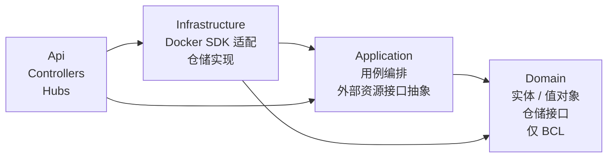

# DDD 落地规范

> 本文档定义 Docker.Manager 后端在 **DDD（领域驱动设计）** 风格下的代码组织、命名约定与依赖方向。
> 适用对象：所有 `src/` 与 `tests/` 下 .NET 项目的贡献者。
>
> **版本**：对应 0.0.1 实施决策（DDD 拆分）。如有调整需同步更新本文与 [architecture.md](./architecture.md)、[constraints.md](./constraints.md)。

---

## 1. 目标

- 统一领域建模风格，让所有贡献者写出"看起来是一个人写的代码"
- 隔离领域核心（Domain）与外部依赖（Infrastructure / API 框架）
- 让代码结构与业务语言对齐，便于审阅与重构
- 为后续 0.0.3 / 0.0.8 / 0.0.9 等迭代的复杂业务逻辑（用户、主机、容器、镜像）打基础

---

## 2. 四层职责

| 项目 | 命名空间根 | 职责 | 典型内容 |
|------|-----------|------|---------|
| `Docker.Manager.Domain` | `Docker.Manager.Domain` | 领域核心。**业务不变量的唯一居所** | 实体、值对象、聚合根、领域事件、领域异常、领域服务、**仓储接口** |
| `Docker.Manager.Application` | `Docker.Manager.Application` | 用例编排。协调领域对象完成用户用例 | 应用服务（`AuthService`、`ContainerService`）、DTO 映射、**外部资源接口抽象**（`IDockerClientFactory`、`IDockerHostAccessor`）、`ApiResult<T>`、`BusinessException` |
| `Docker.Manager.Infrastructure` | `Docker.Manager.Infrastructure` | 第三方适配。落地所有"非业务的技术细节" | `DockerClientFactory`（Docker.DotNet.Enhanced 适配）、**仓储实现**（Dapper + SQLite）、邮件 / 缓存 / 消息队列等适配 |
| `Docker.Manager.Api` | `Docker.Manager.Api` | HTTP/SignalR/WebSocket 边界 | Controllers、Hubs、DI 编排、Serilog、Kestrel 配置、静态前端托管 |

---

## 3. 依赖方向图



**规则**：

- 箭头方向 = 引用方向。箭头尾部依赖箭头头部。
- `Domain` 不得引用任何其他项目，也不得引用任何 NuGet 包
- `Application` 不得引用 `Infrastructure` 或 `Api`
- `Infrastructure` 不得引用 `Api`
- `Api` 是最外层，可以引用 `Application` + `Infrastructure`

**检测手段**：

```bash
# Domain 应无任何 NuGet 依赖
dotnet list src/Docker.Manager.Domain/Docker.Manager.Domain.csproj package --include-transitive

# Application 应仅引用 Domain + 无 NuGet
dotnet list src/Docker.Manager.Application/Docker.Manager.Application.csproj package
```

---

## 4. 基础类型

### 4.1 `Entity<TId>`（实体基类）

```csharp
// src/Docker.Manager.Domain/Common/Entity.cs
public abstract class Entity<TId> where TId : notnull
{
    public TId Id { get; protected set; } = default!;
    public IReadOnlyCollection<IDomainEvent> DomainEvents => /* ... */;
    public void AddDomainEvent(IDomainEvent @event) { /* ... */ }
    public void ClearDomainEvents() { /* ... */ }
    // Equals / GetHashCode 按 Id 判定
}
```

**要点**：

- 实体有"身份"，由 `Id` 决定相等性
- 主键类型推荐 `Guid`；如用强类型 ID（如 `UserId`），应实现 `IEquatable<T>` 或重载相等性
- 领域事件**只有聚合根才能产生**；普通实体不调用 `AddDomainEvent`

### 4.2 `ValueObject`（值对象基类）

```csharp
public abstract class ValueObject
{
    protected abstract IEnumerable<object?> GetEqualityComponents();
    // Equals / GetHashCode 基于 GetEqualityComponents
}
```

**要点**：

- 值对象**不可变**（init-only 属性或 readonly）
- 由"值"定义相等性（无 `Id`）
- 常用于复合类型：`HostEndpoint { Type, Url }`、`PortMapping { Host, Container, Protocol }`

### 4.3 `AggregateRoot<TId>`（聚合根基类）

```csharp
public abstract class AggregateRoot<TId> : Entity<TId>, IAggregateRoot<TId>
    where TId : notnull { }
```

**要点**：

- 继承 `Entity<TId>` 并实现 `IAggregateRoot<TId>`
- 聚合是事务边界：聚合内强一致，聚合间最终一致
- 外部**只能持有聚合根引用**，不能直接访问聚合成员

### 4.4 `IDomainEvent`

```csharp
public interface IDomainEvent
{
    DateTimeOffset OccurredAt { get; }   // UTC
}
```

**要点**：

- 命名过去时态：`ContainerStarted`、`HostRegistered`、`UserLoggedIn`
- 由聚合根在状态变更时产生，仓储 / 工作单元负责派发与清空

### 4.5 `DomainException`

```csharp
public class DomainException : Exception { /* ... */ }
```

**要点**：

- 表达"领域不变量被违反"（如"用户已存在"、"容器名重复"）
- 由聚合根或领域服务抛出
- 应用层捕获并映射到 `ApiResult<T>` 的对应错误码

---

## 5. 命名约定

| 类别 | 约定 | 示例 |
|------|------|------|
| 聚合根 | 名词单数，继承 `AggregateRoot<TId>` | `DockerHost`、`Container`、`Image`、`User` |
| 普通实体 | 名词单数，继承 `Entity<TId>` | （仅聚合成员需要，普通实体少见） |
| 值对象 | 名词，继承 `ValueObject` | `HostEndpoint`、`ContainerStatus`、`PortMapping` |
| 领域事件 | 过去时态，实现 `IDomainEvent` | `ContainerStarted`、`HostRegistered` |
| 领域异常 | `XxxException`，继承 `DomainException` | `HostNotFoundException`、`DuplicateUsernameException` |
| 领域服务 | 行为名词（动名词或名词+Service） | `ContainerDomainService`（少见，仅跨聚合逻辑） |
| 仓储接口 | `IXxxRepository`，定义在 `Domain/Repositories/` | `IUserRepository`、`IHostRepository` |
| 仓储实现 | `XxxRepository`，位于 `Infrastructure/Persistence/` | `UserRepository`、`HostRepository` |
| 外部资源接口 | `IXxxFactory` / `IXxxAccessor`，定义在 `Application/Abstractions/` | `IDockerClientFactory`、`IDockerHostAccessor` |
| 应用服务 | `XxxService`，位于 `Application/Services/` | `AuthService`、`ContainerService` |
| DTO | `XxxDto` 或 `XxxResponse` / `XxxRequest` | `LoginRequest`、`ContainerDto` |
| Controller | `XxxController`，继承 `ControllerBase` | `AuthController`、`ContainerController` |

---

## 6. 接口放置原则

> **核心问题**：拿到一个接口 `IFoo` 时，应该放在哪个项目？

| 类型 | 归属项目 | 判断标准 | 示例 |
|------|---------|---------|------|
| **领域知识**（"管理 X"） | `Domain` | 删除整个外部世界，领域仍能描述业务概念 | `IUserRepository`、`IHostRepository`、`User`、`DockerHost` |
| **外部资源抽象**（"操作外部系统"） | `Application/Abstractions` | 抽象的是某种外部系统（Docker、邮件、缓存、消息队列）；不是业务概念本身 | `IDockerClientFactory`、`IEmailSender`、`IDistributedCacheAccessor` |
| **第三方 SDK 适配** | `Infrastructure` | 包装 / 适配某个具体 SDK；可直接替换为另一 SDK | `DockerClientFactory`（包装 Docker.DotNet.Enhanced）、`SqliteUserRepository`（包装 Dapper + Microsoft.Data.Sqlite） |

**反例**：

- ❌ `IDockerClientFactory` 放在 `Domain` —— Docker 是外部资源，不是领域概念
- ❌ `IUserRepository` 放在 `Application` —— 仓储是领域知识，是聚合的持久化抽象
- ❌ `IEmailSender` 放在 `Domain` —— 邮件是基础设施，不是领域

**经验法则**：先问"这个接口的名字脱离 Docker / .NET / Web 这些技术概念后，还能描述业务吗？"

- 能 → 大概率属于 `Domain`
- 不能 → 大概率属于 `Application/Abstractions`

---

## 7. 聚合内强一致、聚合间最终一致

- **同聚合**：所有修改通过聚合根的方法；事务边界 = 聚合边界
- **跨聚合**：
  - 不要直接调用其他聚合的方法
  - 由源聚合产生**领域事件**，由订阅方（应用服务或领域事件处理器）执行跨聚合修改
  - 跨聚合一致性靠**最终一致**（短暂不一致是可接受的）

**典型场景**：

```
聚合 A：创建容器 → 产生 ContainerCreated 事件
聚合 B（订阅方）：收到事件 → 更新本地缓存 / 触发通知 / 写入审计日志
```

事件分发由仓储 / 工作单元统一处理（0.0.8 起落地）。

---

## 8. 反模式清单

| 反模式 | 表现 | 纠正 |
|--------|------|------|
| **贫血模型** | 实体只有属性，没有行为；所有逻辑写在 Service 里 | 把行为移到聚合根 / 值对象方法 |
| **Entity 直接返回 DTO** | Controller 直接拿 Entity 序列化返回 | 在 Service 层做 Entity → DTO 映射 |
| **聚合根跨边界互相引用** | `Container` 持有 `User` 引用；`User` 持有 `Host` 引用 | 通过 ID 引用（`UserId`、`HostId`）+ 仓储按 ID 加载 |
| **Domain 引用 NuGet 包** | `Domain.csproj` 含 `PackageReference` | 移除；如确需 BCL 之外的能力，移到 `Application` 或 `Infrastructure` |
| **领域服务承担所有逻辑** | 领域服务包含大量业务规则，聚合根成数据袋 | 行为优先归属聚合根；领域服务仅承载跨聚合逻辑 |
| **Application 引用 Infrastructure** | 应用服务直接 `new SqliteConnection()` | 在 `Application/Abstractions` 定义仓储接口，`Infrastructure` 实现并注入 |
| **仓储返回 Entity 列表包含外部资源** | `IHostRepository.ListAsync()` 返回的对象里包含活 `DockerClient` | 仓储只负责持久化；客户端获取走 `IDockerClientFactory` |

---

## 9. 代码示例：DockerHost 聚合根骨架（0.0.8 规划示意）

> 以下代码**仅作示例**，实际 `DockerHost` 在 0.0.8 迭代才落地。

```csharp
// src/Docker.Manager.Domain/Hosts/DockerHost.cs
namespace Docker.Manager.Domain.Hosts;

public sealed class DockerHost : AggregateRoot<Guid>
{
    public string Name { get; private set; } = default!;
    public HostEndpoint Endpoint { get; private set; } = default!;
    public bool Enabled { get; private set; }

    // 私有构造：仅供仓储 / 工厂使用
    private DockerHost() { }

    public static DockerHost Register(
        Guid id, string name, HostEndpoint endpoint)
    {
        ArgumentException.ThrowIfNullOrWhiteSpace(name);
        ArgumentNullException.ThrowIfNull(endpoint);

        var host = new DockerHost
        {
            Id = id,
            Name = name,
            Endpoint = endpoint,
            Enabled = true,
        };
        host.AddDomainEvent(new HostRegistered(id, name));
        return host;
    }

    public void Disable()
    {
        if (!Enabled) return;
        Enabled = false;
        AddDomainEvent(new HostDisabled(Id));
    }
}

// src/Docker.Manager.Domain/Hosts/HostEndpoint.cs
public sealed class HostEndpoint : ValueObject
{
    public DockerHostType Type { get; }
    public string Url { get; }

    public HostEndpoint(DockerHostType type, string url)
    {
        if (string.IsNullOrWhiteSpace(url))
            throw new DomainException("HostEndpoint URL 不能为空");
        Type = type;
        Url = url;
    }

    protected override IEnumerable<object?> GetEqualityComponents()
    {
        yield return Type;
        yield return Url;
    }
}

// src/Docker.Manager.Domain/Hosts/Events/HostRegistered.cs
public sealed record HostRegistered(Guid HostId, string Name) : IDomainEvent
{
    public DateTimeOffset OccurredAt { get; } = DateTimeOffset.UtcNow;
}

// src/Docker.Manager.Domain/Hosts/IHostRepository.cs
public interface IHostRepository
{
    Task<DockerHost?> GetAsync(Guid id, CancellationToken ct = default);
    Task<IReadOnlyList<DockerHost>> ListAsync(CancellationToken ct = default);
    Task AddAsync(DockerHost host, CancellationToken ct = default);
    Task RemoveAsync(Guid id, CancellationToken ct = default);
}
```

要点回顾：

- `DockerHost` 继承 `AggregateRoot<Guid>`，业务行为在聚合根方法中
- `HostEndpoint` 是值对象，构造时校验不变量
- `HostRegistered` / `HostDisabled` 是领域事件，命名过去时态
- `IHostRepository` 定义在 Domain，实现在 Infrastructure
- 私有构造 + 工厂方法（`Register`）确保不变量在创建时即成立

---

## 10. 参考

- Eric Evans《领域驱动设计》（2003）
- Vaughn Vernon《实现领域驱动设计》（2014）
- Microsoft Learn: [.NET Application Architecture Guides](https://learn.microsoft.com/en-us/dotnet/architecture/)
- 项目内：[architecture.md](./architecture.md)、[constraints.md](./constraints.md)、[roadmap.md](./roadmap.md)