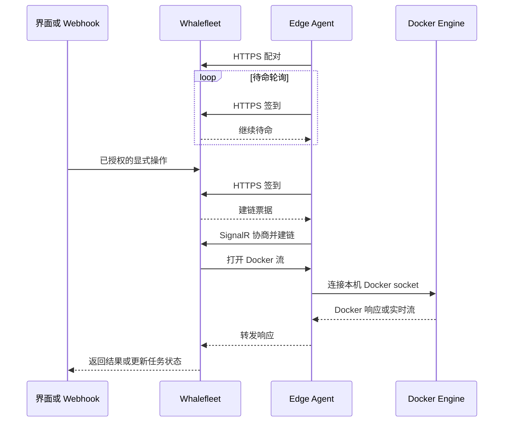

# 0.17.0 Agent 代理管理设计

> 状态为待实现。版本目标和发布顺序见 [路线图](./roadmap.md#0170---agent-代理管理)。

## 范围

在目标主机上运行轻量 Agent，把该主机接入 Whalefleet 的主机管理。首版提供**直连**和 **Edge** 两种模式。
每个 Agent 实例绑定一条主机记录。现有 Socket 和 TCP 主机继续使用原有连接方式。

两种模式均支持现有容器、镜像、卷和网络操作、实时日志和容器指标、容器终端、Compose、
镜像构建、导入导出、文件浏览及资源 Webhook。权限和审计继续由 Whalefleet 处理。
通过 Agent 采集宿主机级实时指标排在 `1.0.0` 之后。

## 竞品对照

| 产品 | 接入方式 | 对 Whalefleet 的参考 |
|---|---|---|
| Portainer | 传统 Agent 由平台主动连接。Edge Agent 出站轮询，按需建立 TLS 隧道，空闲后断开。 | 将待命轮询与管理隧道分开，让 NAT 后的目标只需要出站网络。[Portainer 架构](https://docs.portainer.io/start/architecture) · [Edge Agent 工作流程](https://docs.portainer.io/advanced/edge-agent) |
| Komodo | Periphery 通过双向 WebSocket 通信，支持由 Agent 或 Core 发起连接。 | 两种连接方向共享一套双向通信模型。[Komodo 接入文档](https://komo.do/docs/setup/connect-servers) |
| Arcane | 支持直连与 Edge。Edge 可保持隧道常驻，也可先轮询再按需建链。 | 在界面中明确区分待命与已连接，接受待命后的首次操作需要等待。[Arcane 远程环境](https://arcane.ofkm.dev/docs/features/environments) |
| Dockge | 主实例连接并代理其他 Dockge 实例，在一个界面中管理多台主机的 Compose 项目。 | 浏览器只访问主实例，主机连接由服务端统一处理。[Dockge 1.4 发布说明](https://github.com/louislam/dockge/releases) |

Whalefleet 在直连模式下保持连接，方便持续运维。Edge 使用短 HTTPS 轮询，收到唤醒请求后在同一个平台 HTTPS 入口
建立 SignalR 连接。两种模式以 WebSocket 为首选，在反向代理无法通过 WebSocket Upgrade 时仍可协商其他传输。

## 连接与生命周期

### 直连

1. 运维人员在目标主机启动 Agent，配置 HTTPS 监听和一个安装实例专用的随机凭据。
2. 管理员在 Whalefleet 主机管理中添加 Agent 主机，选择直连并录入 Agent HTTPS 地址及凭据。
3. 主机启用后，Whalefleet 的后台连接管理器作为 SignalR 客户端连接 Agent 的 Hub。
   握手确认安装实例和协议版本后建立会话。网络中断后按退避策略重连。
4. 停用主机时取消重连并关闭现有会话。管理员恢复启用后，用仍有效的配对凭据重新连接。

### Edge

- 默认每 5 秒签到一次并加入抖动。签到更新 Agent 版本和最后联系时间。以连续 3 个签到周期未收到任何有效联系判定
  待命 Agent 离线。建链后用 SignalR 心跳更新最后联系时间，待命轮询可暂停。平台主动结束空闲会话时，
  从关链时刻起重新计签到超时，给 Agent 恢复轮询的时间。
- 用户显式打开 Agent 主机的资源视图、测试连接、发起已授权的资源操作或订阅实时流时，可以发起建链。
  主机列表和全局总览的被动刷新只读取状态。合法资源 Webhook 保留原有的 `202` 与任务 ID，
  由受理后的资源任务申请唤醒。鉴权、限流及覆盖参数校验先于任务入队。
- 同一主机的并发唤醒合并为一次。默认等待 20 秒，到期仍无会话时以 `1301` 表示主机不可达。
  已受理的异步操作在任务结果中记录此错误。等待方取消时只撤销自己的需求。
- 正在执行的前台操作、Webhook 任务及实时订阅持有会话租约。最后一个租约释放后，默认空闲 60 秒关闭 Edge 隧道。
  退出会话时恢复签到。Whalefleet 重启后从内存空状态重建连接，不恢复先前的流和待处理唤醒。

### 后台行为和状态

告警评估、容器异常事件监听和定时镜像检查仅使用已建立的会话。后台工作不创建唤醒请求，也不延长 Edge 空闲期限。
会话关闭后取消关联的后台监听。Edge 在待命期间缺失的事件不补报，待命也不触发主机离线告警。只有已经建链且 Docker 探活失败时，
才按现有规则评估 Docker 连通性告警。识别为 Agent 网络离线时更新连接状态。

| 界面状态 | 判定依据 |
|---|---|
| 待配对 | Edge 主机已创建，Agent 尚未完成配对。 |
| 待命 | Edge 已配对且近期签到成功，当前没有管理会话。 |
| 连接中 | 直连正在拨号，或 Edge 存在尚未满足的唤醒请求。 |
| 已连接 | SignalR 握手成功，当前会话仍有效。Docker 可达性独立显示。 |
| 离线 | 直连线路不可用，或 Edge 待命签到超时。 |
| 连接错误 | 凭据、证书或协议不匹配。界面给出可操作的错误原因。 |
| 已停用 | 主机被管理员停用。 |

## 接口与数据

### 主机管理

- 主机新增 `type: "agent"`，通过 `agentMode: "direct" | "edge"` 区分。直连使用 HTTPS Agent 地址与独立凭据。
  Edge 使用配对生成的绑定记录，创建时无需填写目标地址。持久化使用固定占位值 `agent:edge` 满足现有端点非空约束，
  Edge 响应的 `endpoint` 为空字符串，路由由绑定记录解析。现有 Socket／TCP 的输入、默认值和 JSON 字段语义保持兼容。
- 持久化以 `hosts.id` 关联 Agent 安装标识、模式、凭据及撤销状态。保留原主机 ID、名称、角色分配和审计关联。
  迁移为原有主机保留空 Agent 配置。连接 ID、唤醒请求和流仅保存在平台内存，主机列表与详情使用最新观测状态。
- 现有主机摘要增加可空的 `agentMode`、`agentState`、`agentVersion` 和 `agentLastSeenAt`。
  没有当前 Docker 探活结果时，`reachable` 返回 `null`。界面根据 `agentState` 展示待命或离线，
  根据 `reachable` 展示 Docker 连通性。直连地址保留在主机配置，凭据和配对码仅通过各自的录入或签发入口传递。
  主机可见性继续沿用现有权限规则。

### HTTP 和 Hub

| 入口 | 调用者与行为 |
|---|---|
| `POST /api/v1/admin/hosts/{hostId}/agent/pairing/create` | 具备主机管理权限的管理员为 Edge 主机签发一次性配对码。明文仅在签发响应返回。 |
| `POST /api/v1/admin/hosts/{hostId}/agent/pairing/revoke` | 管理员关闭会话并撤销配对。直连撤销在 Agent 收到后生效，未送达时显示待确认。 |
| `POST /api/v1/hosts/{hostId}/agent/connect` | 具备主机读取权限的用户显式唤醒 Edge，成功后返回当前连接状态。后续资源请求仍按各自权限校验。 |
| `POST /api/v1/agent/enroll` | Edge Agent 提交一次性配对码、安装标识、随机凭据和协议版本。平台从配对码解析绑定主机并原子消费配对码。 |
| `POST /api/v1/agent/check-in` | Edge Agent 用绑定凭据签到。存在唤醒请求时返回短时单次建链票据。 |
| `/hubs/agent` | Edge 对接 Whalefleet 上的 Hub。直连对接 Agent 上的 Hub。两端按模式互换客户端和 Hub 的角色。 |
| `POST /api/v1/agent/direct/revoke` | 直连 Agent 接收平台的已认证撤销请求，确认安装标识后作废本地凭据并关闭该配对的会话。 |

用户入口保持既有 RPC 授权和响应约定，`hostId` 通过路径传递。Agent 机器入口只接受专用凭据。
主机不存在、停用、不可达沿用 `1300`、`1302`、`1301`。已开始返回数据的流在传输失败时关闭，
调用方按现有任务或流错误机制获取结果。

### 凭据与隔离

- 两种模式均使用 HTTPS 并校验服务端身份。直连仅访问管理员配置的 Agent 地址，连接禁用跨地址重定向。
  Agent 凭据与用户 JWT、终端 token 和 MCP PAT 分离。凭据通过请求头或专用请求体传送，排除在日志、审计细节和流诊断之外。
- Edge 在首次注册前把随机安装凭据写入自己的持久卷。平台保存其摘要，与安装标识和主机绑定。
  配对响应丢失时，Agent 可用已持久化的凭据先签到确认配对结果。配对码默认 10 分钟有效，重新签发时废弃同一主机的旧码。
- Edge 的 SignalR 协商和各传输请求使用同一个安装凭据。Hub 建立后，Agent 提交签到取得的建链票据。
  平台仅在成功注册会话时消费票据，确保传输协商与回退能正常重试。票据绑定安装标识、主机和连接代际，
  随唤醒请求到期，完成会话注册后才可传输 Docker 数据。
- 直连凭据只在 Agent 的持久配置与平台加密存储中保留。管理员发起撤销后，平台立即关闭隧道并停止重连，
  专用撤销请求独立重试。目标离线时显示待确认，运维人员也可在目标本地轮换凭据。
  收到目标确认或确认该凭据已被目标拒绝后，平台清理加密凭据。
- 每台主机同一时刻只有一条有效管理会话。重连或配置变更递增会话代际并关闭旧流，迟到帧按旧代际丢弃。
  协议主版本不匹配时拒绝建立数据通道并显示诊断。会话只能打开绑定 Agent 的本机 Docker socket，
  Docker 数据流中没有可选目标地址，也不提供通用网络代理或 Agent 宿主机命令入口。

## Docker 数据通道

请求沿用「浏览器或 Webhook → Whalefleet 用例与授权 → Docker 客户端 → Agent → Docker Engine」的顺序。
Compose 编排、变量解析、操作队列和活动审计仍由平台负责。平台运行的仓库清单探测沿用既有访问方式。
Agent 上的终端能力指容器 exec，遵守原有短时终端令牌与撤权检查。

- 平台保留 `IDockerHostAccessor` 和 `IDockerClientFactory`，在 Infrastructure 给 Agent 类型增加 Docker SDK 传输适配。
  通过 Docker.DotNet.Enhanced 的自定义 handler factory 接入流 opener，并沿用 SDK 的 HTTP 和连接升级处理。
  SDK 打开的一条连接对应隧道中的一个双向流，保留响应头、分块流与写半关闭。内部 HTTP 地址仅用于 SDK 构造请求，
  连接由流 opener 提供，系统 HTTP 代理和重定向在此适配器中禁用。
  Agent 客户端按主机 ID 和连接代际隔离，Socket／TCP 继续用已有池键。
  [Docker SDK 扩展点](https://raw.githubusercontent.com/testcontainers/Docker.DotNet/1e4015a84fa48cbcfe9002ecc4e2cf14177edc2d/src/Docker.DotNet/DockerClientBuilder.cs) · [流接入实现](https://raw.githubusercontent.com/testcontainers/Docker.DotNet/1e4015a84fa48cbcfe9002ecc4e2cf14177edc2d/src/Microsoft.Net.Http.Client/ManagedHandler.cs) · [Docker Exec 接口](https://docs.docker.com/reference/api/engine/version/v1.57/operations/ExecStart/)
- 两种模式采用同一个 JSON Hub 协议。开启协商，依次尝试 WebSocket、SSE、长轮询。Edge 的待命签到是独立的短 HTTPS 请求。
  SSE 和长轮询在管理会话中提供接收通道，配合 HTTP POST 完成反向传输。二进制数据统一以 Base64 承载。
  [SignalR 传输规范](https://github.com/dotnet/aspnetcore/blob/main/src/SignalR/docs/specs/TransportProtocols.md)
- 帧包含会话代际和流 ID。由平台发起打开，Agent 连接本机 Docker socket 后确认。随后按方向递增序号发送最大 16 KiB 的原始数据块。
  收端在数据离开接收缓冲后授予发送额度。初始窗口为每流每方向 4 块，每台主机默认上限 64 条活跃流，
  达到上限时拒绝新流并返回繁忙原因。
  流调度按轮转发送数据帧并优先处理关闭、取消和额度帧，
  避免大文件独占日志或终端。单向关闭保留反方向读写，取消与协议错误关闭对应流并释放 Docker socket。
- 掉线、停用或撤销时取消未完成的流。已经发送给 Docker 且未收到确认结果的写请求标明结果待确认。
  重连只承载后续请求，调用方按资源当前状态决定是否重试。

## 部署与验收

首版以独立的 .NET 10 Agent 容器交付，覆盖 Linux amd64 和 arm64。目标 Docker socket 与 Agent
凭据卷显式挂载。直连需要平台能访问 Agent 的 HTTPS 监听端口，Edge 只需要 Agent 能访问平台 HTTPS 入口。
反向代理示例需覆盖 Upgrade、SSE 禁用缓冲以及长轮询的读超时。开发迭代使用本地构建产物，
对外镜像遵循 [版本段与发布模型](./roadmap.md#版本段与发布模型)。

| 场景 | 验收标准 |
|---|---|
| 接入与回退 | 直连与 NAT 后的 Edge 都可接入，记录实际协商传输。对两种模式分别禁用 WebSocket、再同时禁用 WebSocket 和 SSE，验证 SSE 和长轮询均可完成 Docker 操作。 |
| Edge 生命周期 | 全局总览持续刷新时保持待命。多次显式请求共用一次唤醒，超时给出 `1301`。合法 Compose／容器 Webhook 保持 `202` 契约并唤醒主机。待命时后台任务跳过，租约结束后隧道空闲关闭。 |
| 功能覆盖 | 两种模式均验证容器、镜像、卷和网络操作，日志、指标和终端输入／resize，Compose 部署进度、镜像构建、导入导出及文件浏览。 |
| 流行为 | 在三种传输上验证终端输入、输出与写半关闭。上传和下载跨多块的大文件并校验摘要，同时运行短请求与终端交互，检查缓冲有界且交互可继续。 |
| 身份与权限 | 验证过期或已使用的配对码、不同主机间凭据错用、停用、撤销、直连撤销待确认、不可验证的 TLS 证书以及版本不兼容。复核受限用户只能操作授权资源，撤权后已有实时流按原规则结束。 |
| 恢复与兼容 | 断开 Agent、Docker 或反向代理，重启平台后恢复连接。验证旧流和已发出的写请求不会被重放，凭据不会进入日志。升级既有数据库后，Socket／TCP 连接、主机权限及审计关联正常。 |
